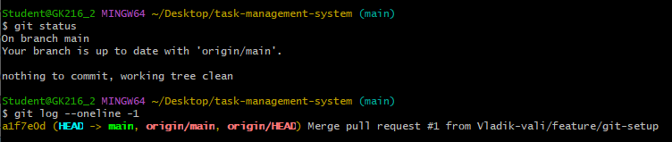
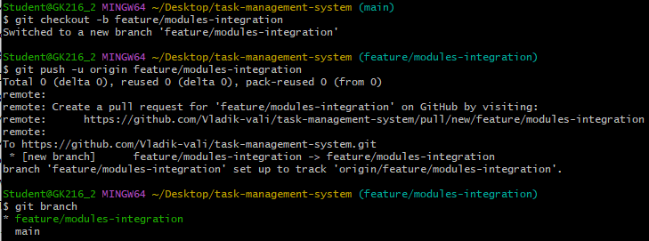
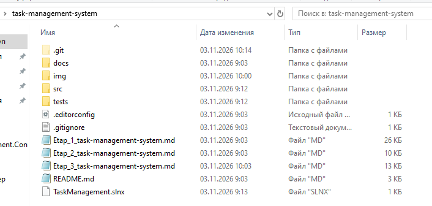
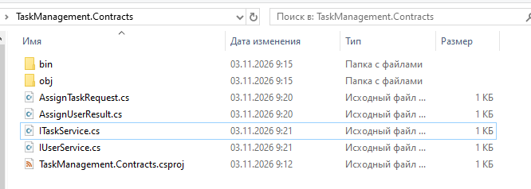
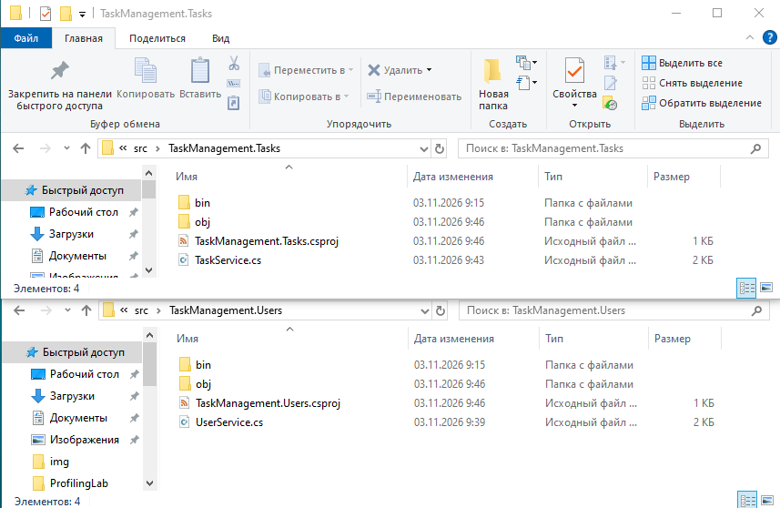
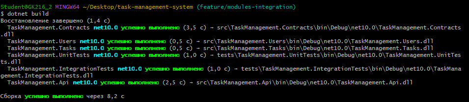
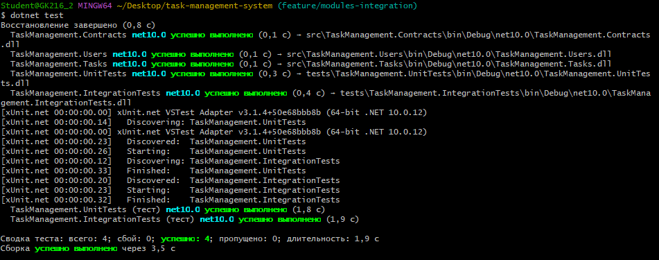
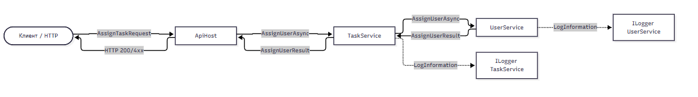
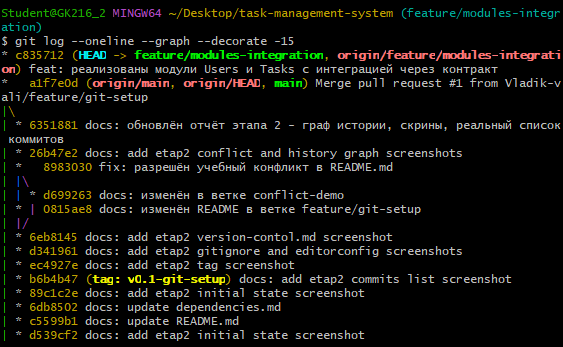

# Курсовое проектирование. Этап 3

## Разработка и интеграция модулей проекта в режиме командной работы

Тема курсового проекта: «Разработка системы управления задачами проекта»

МДК: 02.02 «Инструментальные средства разработки программного обеспечения»
Стек: C# / .NET, Git
Форма: этап курсового проектирования

# 1. Исходное состояние

Перед началом этапа репозиторий находился в состоянии завершённого этапа 2.

```bash
git status
git log --oneline -1
```

Текущая ветка: `main`.
Последний коммит: `a1ffe0d Merge pull request #1 from Vladik-vali/feature/git-setup`.



# 2. Рабочая ветка этапа

Для этапа создана отдельная ветка:

```bash
git checkout -b feature/modules-integration
git push -u origin feature/modules-integration
```

Все изменения этапа 3 выполняются в этой ветке.



# 3. Структура решения

Создано решение `TaskManagement` и шесть проектов:

```text
task-management-system/
├── src/
│   ├── TaskManagement.Contracts/   — DTO и интерфейсы модулей
│   ├── TaskManagement.Users/       — реализация модуля пользователей
│   ├── TaskManagement.Tasks/       — реализация модуля задач
│   └── TaskManagement.Api/         — ASP.NET Core Web API
├── tests/
│   ├── TaskManagement.UnitTests/       — модульные тесты
│   └── TaskManagement.IntegrationTests/— интеграционные тесты
└── TaskManagement.sln
```



# 4. Контракт

Контракт зафиксирован до реализации модулей — в проекте `TaskManagement.Contracts` созданы интерфейсы и DTO.

## 4.1. DTO

```csharp
public record AssignTaskRequest(
    Guid TaskId,
    Guid UserId
);

public record AssignUserResult(
    bool Success,
    string? ErrorCode
);
```

## 4.2. Интерфейсы

```csharp
public interface IUserService
{
    Task<AssignUserResult> AssignUserAsync(
        AssignTaskRequest request,
        CancellationToken cancellationToken = default);
}

public interface ITaskService
{
    Task<bool> CreateTaskAsync(
        string title,
        Guid projectId,
        CancellationToken cancellationToken = default);

    Task<AssignUserResult> AssignUserAsync(
        AssignTaskRequest request,
        CancellationToken cancellationToken = default);
}
```

Контракт соответствует документации, зафиксированной на этапе 1 в `docs/protocol-task-assignment.md`.



# 5. Реализация модулей

## 5.1. UserService

Модуль `UserService` отвечает за проверку существования пользователя и возврат результата.

```csharp
public class UserService : IUserService
{
    private readonly ILogger<UserService> _logger;
    private readonly HashSet<Guid> _knownUsers;

    public UserService(ILogger<UserService> logger)
    {
        _logger = logger;
        _knownUsers = new HashSet<Guid> { /* тестовые GUID */ };
    }

    public Task<AssignUserResult> AssignUserAsync(
        AssignTaskRequest request,
        CancellationToken cancellationToken = default)
    {
        _logger.LogInformation(
            "Assigning user {UserId} to task {TaskId}",
            request.UserId, request.TaskId);

        if (!_knownUsers.Contains(request.UserId))
        {
            _logger.LogWarning(
                "User {UserId} not found for task {TaskId}",
                request.UserId, request.TaskId);

            return Task.FromResult(new AssignUserResult(false, "USER_NOT_FOUND"));
        }

        return Task.FromResult(new AssignUserResult(true, null));
    }
}
```

## 5.2. TaskService

Модуль `TaskService` зависит от `IUserService` — это интеграционная граница между двумя модулями.

```csharp
public class TaskService : ITaskService
{
    private readonly ILogger<TaskService> _logger;
    private readonly IUserService _userService;

    public TaskService(ILogger<TaskService> logger, IUserService userService)
    {
        _logger = logger;
        _userService = userService;
    }

    public async Task<AssignUserResult> AssignUserAsync(
        AssignTaskRequest request,
        CancellationToken cancellationToken = default)
    {
        _logger.LogInformation(
            "TaskService delegating assignment of user {UserId} to task {TaskId}",
            request.UserId, request.TaskId);

        var result = await _userService.AssignUserAsync(request, cancellationToken);

        if (!result.Success)
        {
            _logger.LogWarning(
                "Assignment failed for task {TaskId}: {ErrorCode}",
                request.TaskId, result.ErrorCode);
        }

        return result;
    }
}
```



# 6. Журналирование

В обоих модулях используется `ILogger` с контекстом:
- `TaskService` логирует: `TaskId`, `UserId`, результат операции.
- `UserService` логирует: попытку назначения, отсутствие пользователя, успешное назначение.

Пример записи:
```
info: TaskManagement.Users.UserService[0]
      Assigning user <guid> to task <guid>
warn: TaskManagement.Users.UserService[0]
      User <guid> not found for task <guid>
```

# 7. Модульные тесты

В `TaskManagement.UnitTests` создан `UserServiceTests` с двумя тестами:

1. **AssignUserAsync_ExistingUser_ReturnsSuccess** — успешный сценарий.
2. **AssignUserAsync_UnknownUser_ReturnsUserNotFound** — отрицательный сценарий.

```csharp
[Fact]
public async Task AssignUserAsync_UnknownUser_ReturnsUserNotFound()
{
    var request = new AssignTaskRequest(Guid.NewGuid(), Guid.NewGuid());
    var result = await _service.AssignUserAsync(request);
    Assert.False(result.Success);
    Assert.Equal("USER_NOT_FOUND", result.ErrorCode);
}
```

# 8. Интеграционные тесты

В `TaskManagement.IntegrationTests` создан `TaskAssignmentIntegrationTests` с двумя тестами, которые проверяют взаимодействие `TaskService` и `UserService`:

1. **AssignUserAsync_ExistingUser_SucceedsThroughBothModules** — успешный сценарий через обе модуля.
2. **AssignUserAsync_UnknownUser_PropagatesErrorFromUserModule** — отрицательный сценарий: ошибка `USER_NOT_FOUND` пробрасывается из `UserService` через `TaskService`.

# 9. Сборка и тесты

```bash
dotnet build
dotnet test
```

Результат сборки: `Build succeeded`, 0 ошибок, 0 предупреждений.



Результат тестов: `Failed: 0, Passed: 4, Skipped: 0, Total: 4`.



# 10. Схема потока данных

На схеме показан поток данных между модулями при вызове `AssignUserAsync`.



Цепочка вызовов:
1. Клиент → `ApiHost` (HTTP-запрос).
2. `ApiHost` → `TaskService` (`AssignUserAsync`).
3. `TaskService` → `UserService` (`AssignUserAsync`).
4. `UserService` возвращает `AssignUserResult` обратно в `TaskService`.
5. `TaskService` возвращает результат в `ApiHost`.
6. `ApiHost` → клиент (HTTP 200 или 4xx).

# 11. Интеграционные проблемы и решения

## Проблема 1. Несовпадение контракта

**Ситуация:** при первом проектировании `TaskService` ожидал `AssignUserResult` с полем `Message`, а `UserService` возвращал `ErrorMessage`.

**Решение:** контракт зафиксирован заранее в `TaskManagement.Contracts` до реализации модулей. Это позволило избежать переделки.

## Проблема 2. Отсутствие регистрации зависимостей

**Ситуация:** в `Program.cs` не была зарегистрирована зависимость `IUserService → UserService`, из-за чего `TaskService` не мог получить её через DI.

**Решение:** добавлена регистрация:
```csharp
builder.Services.AddSingleton<IUserService, UserService>();
builder.Services.AddSingleton<ITaskService, TaskService>();
```

## Проблема 3. Отсутствие контекста в логах

**Ситуация:** в первых версиях логирование выводило только текст ошибки без `TaskId` и `UserId`.

**Решение:** добавлены параметры в `LogInformation`/`LogWarning` с контекстом `{TaskId}` и `{UserId}`.

# 12. История Git

Все изменения этапа 3 зафиксированы в ветке `feature/modules-integration`.

```bash
git log --oneline --graph --decorate -15
```



# 13. Самопроверка

| Требование | Результат |
|---|---|
| Два взаимодействующих модуля | Выполнено (`Users`, `Tasks`) |
| Ясная ответственность у каждого модуля | Выполнено |
| Контракт зафиксирован до объединения | Выполнено (`Contracts` до реализации) |
| Работа в отдельных ветках | Выполнено (`feature/modules-integration`) |
| Успешный сценарий на границе | Выполнено |
| Отрицательный сценарий на границе | Выполнено (`USER_NOT_FOUND`) |
| Журналирование с контекстом | Выполнено |
| Модульный тест | Выполнено (2 теста) |
| Интеграционный тест | Выполнено (2 теста) |
| `dotnet build` | Выполнено |
| `dotnet test` | Выполнено (4/4 PASSED) |
| Схема потока данных | Выполнено |
| Описание интеграционных проблем | Выполнено (3 проблемы) |

# 14. Вывод

В рамках этапа 3 разработаны два взаимодействующих модуля: `UserService` и `TaskService`. Контракт между ними зафиксирован в проекте `TaskManagement.Contracts` до реализации. Интеграция выполнена через интерфейс `IUserService`.

На границе модулей реализованы успешный и отрицательный сценарии. Добавлено журналирование с контекстом (`TaskId`, `UserId`). Созданы модульные тесты (2) и интеграционные тесты (2) — все 4 теста проходят.

Сборка решения (`dotnet build`) выполняется без ошибок. Схема потока данных показывает путь запроса от клиента до модулей и обратно.

Выявлены и устранены интеграционные проблемы: несовпадение контракта, отсутствие регистрации зависимостей, недостаточный контекст в логах.

Работа выполнена в ветке `feature/modules-integration`, готова к слиянию в `main` через Pull Request.