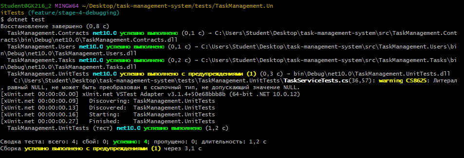

# Отчёт по этапу 4 «Отладка отдельных модулей»

## 1. Цель работы
Проверить работу модулей системы управления задачами, выявить ошибки обработки входящих данных, исправить их и подтвердить результат автоматизированными тестами.

## 2. Обнаруженные дефекты

### Дефект 1. Создание задачи с пустым идентификатором проекта (ProjectId)
**Симптом:** метод `CreateTaskAsync` возвращал `true` и принимал задачу, даже если в качестве `projectId` передавался пустой `Guid` (`Guid.Empty`). Задача создавалась в «вакууме».
**Причина:** в сервисе `TaskService` отсутствовала предварительная проверка поля `projectId` на пустое значение.
**Исправление:** добавлена проверка `if (projectId == Guid.Empty)` в метод `CreateTaskAsync`. При некорректных данных метод возвращает `false` и пишет предупреждение в лог.
**Проверка:** добавлен unit-тест `CreateTask_EmptyProjectId_ShouldReturnFalse`.

### Дефект 2. NullReferenceException при передаче пустого запроса на назначение исполнителя
**Симптом:** при попытке вызвать `AssignUserAsync` с параметром `request = null` приложение падало с исключением `NullReferenceException`.
**Причина:** в методе `AssignUserAsync` отсутствовала проверка входящего объекта на `null` перед обращением к его свойствам (`request.UserId`).
**Исправление:** добавлена проверка `if (request == null)`. При некорректных данных метод безопасно возвращает `AssignUserResult(false, "INVALID_REQUEST")`.
**Проверка:** добавлен unit-тест `AssignUser_NullRequest_ShouldReturnError`.

## 3. Средства разработки
* C# и .NET 10 (согласно csproj)
* Visual Studio (или VS Code)
* Git и GitHub
* xUnit (и Moq для создания моков)

## 4. Результаты тестирования
После внесения исправлений выполнена команда `dotnet test`.
По результатам локального запуска: **Сбоев: 0, Успешно: 4** (включая интеграционные и новые unit-тесты). Ошибок тестирования не обнаружено.

## 5. Организация работы
Работа выполнялась в ветке `feature/stage-4-debugging` (создана от `main`). Исправления фиксировались отдельными коммитами в формате Conventional Commits (например, `fix: добавлена валидация ProjectId и проверка на null в TaskService`).

## 6. Вывод
В коде отлажены выявленные неисправности и исправлены ошибки проверки входящих данных в модуле задач. Добавлены тесты для проверки некорректных запросов (пустой ID и null). Локальный запуск тестов подтвердил успешное прохождение всех тестов.